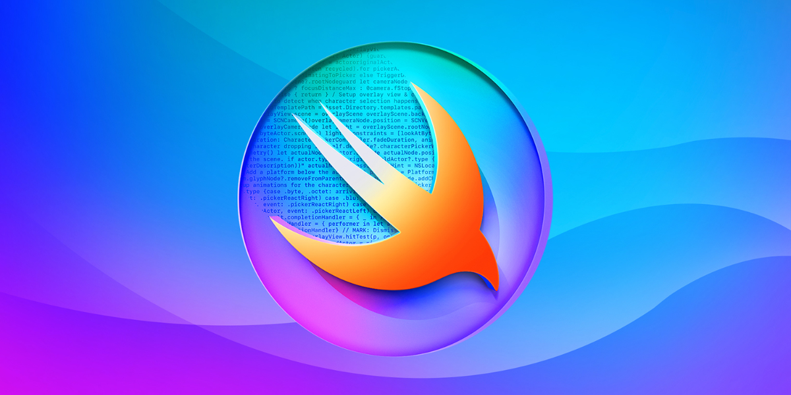

# WWDC 2025 - Swift Student Challenge

List of student submissions for the WWDC 2025 - Swift Student Challenge. The list is in alphabetical order.

Check out the [YouTube Playlist](https://youtube.com/playlist?list=PL0GynU2GmYtQhEjMX1i8KR3By7SugZEHL&si=k-e0kU_MboQ9uuWM) to watch the projects.

### How to add your submission?
1. **[Click here to open the form](https://github.com/wwdc/2025/issues/new?template=submit.yml)** and fill it in.
2. Send it. A bot checks your entry within a minute and tells you if anything needs fixing. You can edit the form after sending.
3. When it is approved your entry appears on this list.

#### How to update or remove your submission?
Use the **[update form](https://github.com/wwdc/2025/issues/new?template=update.yml)**. Only the person who sent the entry can change it.

### Submissions

| Participant | Links  | Status                |
|:--|:--|:--|
| [Akshat Saladi](https://akshat-hotpage.vercel.app/) Hero Coach | [GitHub](https://github.com/Akshat2923/Hero-Coach) · [Video](https://www.youtube.com/watch?v=A0phG_YCdII) SwiftUI, SwiftData, CreateML, CoreML +4 |  |
| [Alessio Rubicini](https://alessiorubicini.github.io) Screenplay Genie | [GitHub](https://github.com/alessiorubicini/Screenplay-Genie) SwiftUI |  |
| Alexandros Samonakis Puppestro | [GitHub](https://github.com/AloneAlexandros/SSC2025) · [Video](https://youtu.be/qnYDLUdTiG8) SwiftUI, Vision, AVFoundation, UIKit |  |
| [Alpay Calalli](https://www.linkedin.com/in/alpay-calalli-a72bb0248/) BasketballAnalyzer | [GitHub](https://github.com/alpaycli/BasketballAnalyzer) · [Video](https://x.com/calalli24/status/1893307035933938008) SwiftUI, UIKit, Vision |  |
| András Baki FindTheApple | [GitHub](https://github.com/ANDREW414E44524557/findtheapple) SwiftUI, Foundation |  |
| [Arnav Singhal](https://www.linkedin.com/in/arnavarw/) Elmora | [GitHub](https://github.com/Arnav-arw/Elmora-SSC-2025) Swift, SwiftUI |  |
| [Asser Osama](https://www.linkedin.com/in/asserusama/) VRTBRA | [Video](https://youtu.be/b1dvqV9dZwo?si=Acd2yAONKrWTEb24) Vision, SwiftUI, AVFoundation |  |
| [Ayush Srivastava](https://x.com/ayushsrivastv) ThisSide | [GitHub](https://github.com/ayushshrivastv/ThisSide) SwiftUI, MapKit, HealthKit |  |
| [Chawabhon Netisingha (Jnx03)](https://www.jnx03.xyz/) Syntaxia | [GitHub](https://github.com/JNX03/Syntaxia) · [Video](https://youtu.be/zJ4cAt7An84) SwiftUI, Speech synthesis, NaturalLanguage, AVFoundation +5 |  |
| [Chris Pagolu](https://www.linkedin.com/in/chris-pagolu-837368246/) Tree Buddy | [GitHub](https://github.com/AllStars101-sudo/Tree-Buddy) SwiftUI, RealityKit, ARKit, TipKit +4 |  |
| [Dhruv Goswami](https://www.linkedin.com/in/Dhruv-Goswami-24-/) Error 404: Game not found | [GitHub](https://github.com/DhruvGoswami10/Error_404-Game_not_found_SSC) SwiftUI, SpriteKit, CoreML |  |
| [Dyari Bahadin](https://x.com/0dbug_) Armillary | [GitHub](https://github.com/0xdbug/Armillary) · [Video](https://youtu.be/ogBnf7YMmGY?si=XB_wk4u2zCR9ecPj) SwiftUI, SceneKit |  |
| [Fayaz Shaikh](https://fayaz.one) GyroCam | [GitHub](https://github.com/fayaz12g/GyroCam) · [Video](https://www.youtube.com/watch?v=q6XoJlkMB5Q) SwiftUI, AVFoundation, CoreMotion, CoreLocation |  |
| [Francesco Paciello](https://x.com/paciosdev) Adventure of a Disinguished Winner | [GitHub](https://github.com/paciosdev/Adventure-of-a-Distinguished-Winner-SSC25-) SwiftUI, SpriteKit, AVFoundation, PencilKit +3 |  |
| [Htet Aung Shine](https://www.linkedin.com/in/htet-aung-shine-41ab62256/) EcoVision | [GitHub](https://github.com/HtetAungShine6/EcoVision.git) SwiftUI, CoreML, AVFoundation, Vision |  |
| [Hunor Zoltáni](https://ronuhz.me) (Not) Lost | [GitHub](https://github.com/Ronuhz/Swift-Student-Challenge-2025) SwiftUI, AVKit, Observation |  |
| [Ian Quibete](https://github.com/nexteurarian) Tracks | [GitHub](https://github.com/nexteurarian/TracksAPP) SwiftUI, Foundation |  |
| [Jack Miller](https://jackmiller.dev) AquaQuest | [GitHub](https://github.com/millerswiftdev/AquaQuest) RealityKit, SwiftData, TipKit |  |
| [James Deming Kong](https://jameskong098.github.io/) Home Gym | [GitHub](https://github.com/jameskong098/home-gym) · [Video](https://www.youtube.com/watch?v=dsgAGXltOJE) SwiftUI, Vision, Charts, AVSpeechSynthesizer |  |
| Jianxi Peng Binary Jigasw | [GitHub](https://github.com/Alreiters) SwiftUI |  |
| Jiya Damara Pet SOS | [Video](https://www.youtube.com/shorts/kLbambDEPU0) SwiftUI |  |
| [José Alencar](https://www.linkedin.com/in/josevalencar/) Brian | [GitHub](https://github.com/josevalencar/SSC-25) SwiftUI, CoreML, Metal |  |
| [Jotaro Sugiyama](https://x.com/sugijotaro) Kirigami | [GitHub](https://github.com/sugijotaro/Kirigami-SSC25) · [Video](https://www.youtube.com/watch?v=Hxq6_Sf9lFE) SwiftUI |  |
| [Kevin Mekic](https://www.linkedin.com/in/kevin-mekic-b5833b170/) Social Battery Tracker | [GitHub](https://github.com/kevinmekic/wwdc2025) SwiftUI |  |
| [Khaled Samim](https://github.com/itkhld1) Planet 🪐 | [GitHub](https://github.com/itkhld1/Planet/tree/main) Swift, SwiftUI, CoreAnimation |  |
| Kosei Miyamoto Pip&amp;Forest | [GitHub](https://github.com/user-attachments/files/19820310/Pip.Forest.swiftpm.zip) SwiftUI, AVFoundation, PencilKit |  |
| [Leandro](https://x.com/Droni0s) the Terminal-tor | [GitHub](https://github.com/Lxdro/the_Terminal-tor) SwiftUI, AVKit |  |
| [Leandro Tolaini](https://x.com/Droni0s) the Terminal-tor | [GitHub](https://github.com/Lxdro/the_Terminal-tor) SwiftUI |  |
| [Lucas Lavajo](https://tryon-lab.fr) Movies | [GitHub](https://github.com/tryon-dev/wwdc2025) SwiftUI, CoreMotion, Vision |  |
| [Lukas Lauerer](https://www.twitter.com/custusfox) SpotOn | [GitHub](https://github.com/Black-Fox-2022/SpotOn-SSC25) SwiftUI, AVFoundation |  |
| [Mhmd Ebrahim](https://www.linkedin.com/in/mhmd-ebrahim) Okaz | [Video](https://youtu.be/QXox8H-kWo0?si=BJue2fhX-Rt0aUUB) SwiftUI, PS algorithms |  |
| [Min Jae Lee](https://www.linkedin.com/in/mini-min/) Eolssu | [GitHub](https://github.com/mini-min/Eolssu) · [Video](https://www.youtube.com/watch?v=CUOGi5JISF8) SwiftUI, AVFoundation, Combine |  |
| [Morris Richman](https://mcrich23.com) Anchor | [GitHub](https://github.com/Mcrich23/Anchor) · [Video](https://github.com/user-attachments/assets/beb6a3f1-38db-4475-8765-00a0d28a4164) SwiftUI, Speech, CoreHaptics, PencilKit |  |
| [Myung Joon Kang](https://myungjoon.com) SpeechPath | [Video](https://myungjoon.com/speechpath) SwiftUI, AVFoundation, Speech |  |
| [OliverPark](https://www.olivergpark.com) JeongKimchi | [GitHub](https://github.com/oliver0828-dev/JeongKimchi) SwiftUI, MapKit, SwiftData |  |
| [Om Chachad](https://omchachad.com) Dub Dub Circle | [GitHub](https://github.com/OmChachad/DubDubCircle) · [Video](https://youtu.be/NkXkQP9AP_g) SwiftUI, VisionKit, Genmoji, SwiftData +5 |  |
| [Paulo Brand](https://www.linkedin.com/in/paulobrand) BeatSync | [GitHub](https://github.com/PauloBrand7/BeatSync-WWDC25) SwiftUI, AVFoundation, SceneKit |  |
| [Philipp Ollmann](https://philipp-ollmann.super.site/) Fidget Synth | [GitHub](https://github.com/philippollmann/wwdc25-fidgetsynth) · [Video](https://youtu.be/NHBF3pVmhHw) SwiftUI, CoreAudio |  |
| Raphaël Schröder ReCall | [GitHub](https://github.com/raphckrman/WWDC-SSC) SwiftUI, CoreHaptics, SwiftData, UserNotifications |  |
| [Richard Simonik](https://linkedin.com/in/richard-%C5%A1imon%C3%ADk-6603712a2) CPR Helper | [GitHub](https://github.com/risasim/CPRHelperv2) SwiftUI |  |
| [Riju Ishiwatari](https://x.com/acrostorn?s=21) OrbitPlay | [GitHub](https://github.com/acrostorn/OrbitPlay) · [Video](https://www.youtube.com/watch?v=GaSuNM9kLKg) SwiftUI, ARKit, SceneKit, Charts |  |
| [Rodrigo Pellanda](https://x.com/pllenin42) Vertigo | [Video](https://youtu.be/ic7mI4TN35k) SwiftUI, SpriteKit, RealityKit, GameplayKit |  |
| [Rodrigo Soares](https://linkedin.com/in/roosoars) FaceQuiz | [GitHub](https://github.com/roosoars/FaceQuiz) SwiftUI, CoreML, AVFoundation |  |
| [Roman Zhuzhgov](https://t.me/mi11ione) Odyssey | SwiftUI, ARKit, RealityKit, TipKit +1 |  |
| [Roscoe Rubin-Rottenberg](https://knotbin.xyz) Cue | [GitHub](https://github.com/knotbin/ssc-25) · [Video](https://youtu.be/GgueyJrMiuQ?si=OmIf2fHv0LlNXYWk) SwiftUI, Speech, AVFoundation, Combine |  |
| [Sahil Prasad](https://x.com/sailorworks) AR Mastermind | [GitHub](https://github.com/sailorworks/swift25) SwiftUI, RealityKit, Combine |  |
| Si Yu Sun Learn by Reading - Chinese Edition | [GitHub](https://github.com/siyusun02/ssc25-learn-by-reading-chinese) · [Video](https://www.youtube.com/shorts/PT9LMYptGUk) SwiftUI, PDFKit |  |
| [Soleil Chao](https://www.linkedin.com/in/soleil-chao/) Privacy Conscious | SwiftUI, AVFoundation |  |
| [Stefanus Albert Wilson](https://www.stefanuswilson.com) GuardUp | [GitHub](https://github.com/abedsully/GuardUp) SwiftUI, CoreML |  |
| [Theeratdolchat Chatchai](https://github.com/Theerat22) ReKeeper | [GitHub](https://github.com/Theerat22/ReKeeper) · [Video](https://youtu.be/hx3YWWz6F28?si=N1tH4uGe8BwLjn3d) SwiftUI, AVFoundation, Vision, PhotosUI |  |
| [Venus Bhatia](https://x.com/venusbhatia) Connect The Dots | [Video](https://www.youtube.com/shorts/6smlF4eMXp8) SwiftUI |  |
| [Vitória Beltrão](https://www.linkedin.com/in/vitoriabeltrao/) Emotionpedia | [GitHub](https://github.com/vbwo/Emotionpedia-SSC25) · [Video](https://www.youtube.com/watch?v=I3oGPtrsfME) SwiftUI, ARKit, RealityKit, Vision |  |
| [Xingyu Lu](https://discord.gg/58tJaJNP) Pencil nib | [Video](https://youtu.be/oRIB38hXKTc) SwiftUI, UIKit, PencilKit, AVFoundation |  |
| [Zehao (Dylan) Lin](https://www.linkedin.com/in/zdlin/) SmartFridge | SwiftUI, SwiftData |  |

##### Total: 54 | Awarded: 28
